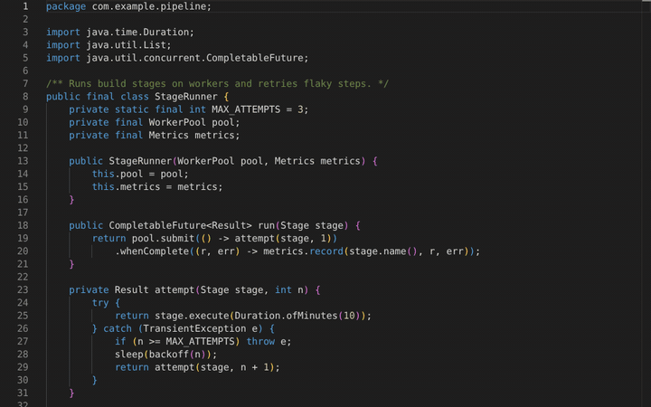
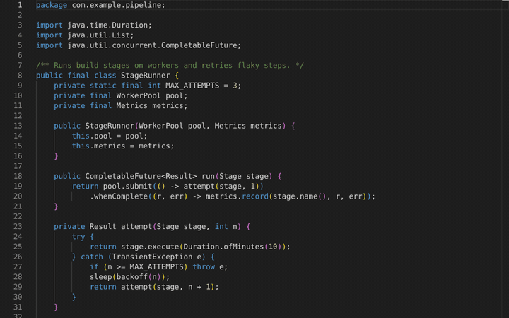

# VS Code Effects

Custom visual effects for the VS Code editor.

| Effect | Extension | What it does |
|---|---|---|
| Black hole | [`black-hole-break`](black-hole-break) | On a timer, the code spirals into a black hole. The editor stays empty for a short eye rest. Then the code spirals back out. |
| Dust | [`black-hole-break`](black-hole-break) (`"blackHoleBreak.effect": "dust"`) | The code turns grey, breaks into dust and blows away. Then the dust flies back. |



<details>
<summary>Dust effect</summary>



</details>

The effects only add editor decorations. They do not change your files.

---

## Set up

### Requirements

| Item | Version | Check |
|---|---|---|
| VS Code | 1.85 or later | **Code > About Visual Studio Code** |
| Node.js | 18 or later | `node -v` |
| `code` command | — | `code -v`. If it is missing: in VS Code, push `Cmd+Shift+P` (`Ctrl+Shift+P`) and run **Shell Command: Install 'code' command in PATH**. |
| Git | any | `git --version` |

### Procedure A: script (macOS / Linux)

1. Clone the repository:
   ```bash
   git clone https://github.com/gkannan011192/vs-code-effects.git
   cd vs-code-effects
   ```
2. Run the setup script. It runs the tests, builds the extension package, removes the old Dust Break extension (if installed) and installs Black-Hole Break:
   ```bash
   ./install.sh
   ```
3. In VS Code, push `Cmd+Shift+P` and run **Developer: Reload Window**.
4. Make sure that the status bar (right side) shows an eye icon and `10m`.
5. To see the effect now, run **Black-Hole Break: Take a Break Now**.

### Procedure B: manual (all platforms, also Windows)

1. Clone the repository (step 1 above).
2. Build the extension package:
   ```bash
   cd black-hole-break
   npm test
   npx --yes @vscode/vsce package
   ```
   This makes `black-hole-break-<version>.vsix` in the `black-hole-break` folder.
3. Install it. Use one of these:
   - Terminal: `code --install-extension black-hole-break-<version>.vsix --force`
   - VS Code: `Cmd+Shift+P` > **Extensions: Install from VSIX...** > select the file.
4. Reload the VS Code window.

### Procedure C: run from source without install (development)

1. Open the `black-hole-break` folder in VS Code.
2. Push `F5`. A second VS Code window (Extension Development Host) starts with the extension.
3. In that window, run **Black-Hole Break: Take a Break Now**.

### Update

```bash
git pull
./install.sh
```

Then reload the VS Code window.

### Remove

```bash
code --uninstall-extension local-dev.black-hole-break
```

---

## Configure

The defaults are: a break every 10 active minutes, a 20 s rest, all day, every day, black hole effect.
To change them, open **Settings** (`Cmd+,`) and search for `blackHoleBreak`, or edit `settings.json`:

```jsonc
{
  "blackHoleBreak.effect": "blackHole",          // or "dust"
  "blackHoleBreak.intervalMinutes": 10,          // active minutes between breaks
  "blackHoleBreak.restSeconds": 20,              // length of the empty-editor rest
  "blackHoleBreak.activeHours": "",              // e.g. "09:00-12:30, 13:30-18:00"; empty = all day
  "blackHoleBreak.activeDays": ["Sun", "Mon", "Tue", "Wed", "Thu", "Fri", "Sat"],
  "blackHoleBreak.endOnActivity": true,          // typing or clicking ends a break
  "blackHoleBreak.ghostOpacity": 0,              // 0 = fully empty editor during the rest
  "editor.minimap.enabled": false                // optional: the minimap is not hidden by the effect
}
```

All settings, the commands and the time model are in [`black-hole-break/README.md`](black-hole-break/README.md).

---

## Repository layout

| Path | Contents |
|---|---|
| `black-hole-break/` | The VS Code extension (JavaScript, no build step, no runtime dependencies) |
| `black-hole-break/src/blackhole.js` | Black hole effect: pure logic (spiral vectors, stages, hole size, CSS) |
| `black-hole-break/src/blackhole-renderer.js` | Black hole effect: VS Code decorations |
| `black-hole-break/src/core.js` | Dust effect: pure logic, and the schedule parser |
| `black-hole-break/src/renderer.js` | Dust effect: VS Code decorations |
| `black-hole-break/src/timeline.js`, `timer.js` | Animation clock, active-time counter |
| `black-hole-break/test/` | Tests (`npm test`, Node built-in test runner with a fake `vscode` module) |
| `black-hole-break/media/` | Preview GIFs |
| `preview/` | Browser preview of the effects in a Monaco editor, and the GIF recorder |
| `install.sh` | Build and install script |
| `.github/workflows/ci.yml` | CI: tests and a package check on each push |

## Preview the effects in a browser

The preview uses the Monaco editor (the editor inside VS Code) and the same decoration CSS as VS Code.

```bash
cd preview
npm install
npm run serve            # opens preview/index.html: effect switch, Play break, timeline slider
```

To record the GIFs again (needs Chrome or Chromium and `ffmpeg`):

```bash
CHROME_PATH="/Applications/Google Chrome.app/Contents/MacOS/Google Chrome" npm run record:blackhole
CHROME_PATH="/Applications/Google Chrome.app/Contents/MacOS/Google Chrome" npm run record:dust
```

## How an effect works

1. The extension splits each visible line into grains of 1-3 characters.
2. Each grain gets a fixed `delay` and `life`. Its look at time `t` is a pure function of `t`.
3. Each look is a VS Code text decoration type. VS Code copies the `textDecoration` value into the CSS rule, so a decoration can add `transform`, `filter` and CSS custom properties.
4. The clock adds real elapsed time to `t`. A lower frame rate gives fewer frames, not a longer animation. Reverse play gives an exact restore.

To add an effect: write a pure module (like `src/blackhole.js`) and a renderer with the same methods as `BlackHoleRenderer` (`kind`, `duration`, `begin`, `add`, `sync`, `invalidate`, `setMessage`, `render`, `clear`, `dispose`). Then add its name to `blackHoleBreak.effect` in `package.json` and to the selection in `extension.js`.

## License

MIT. See [LICENSE](LICENSE).
